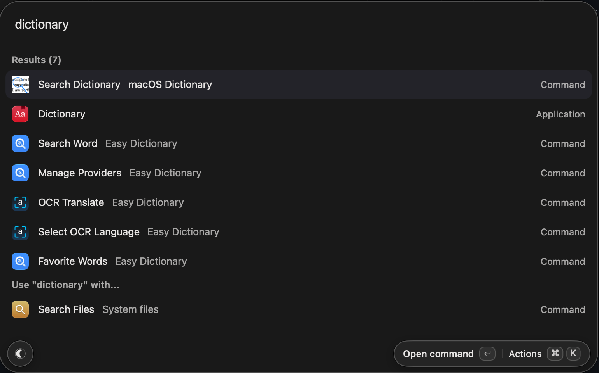
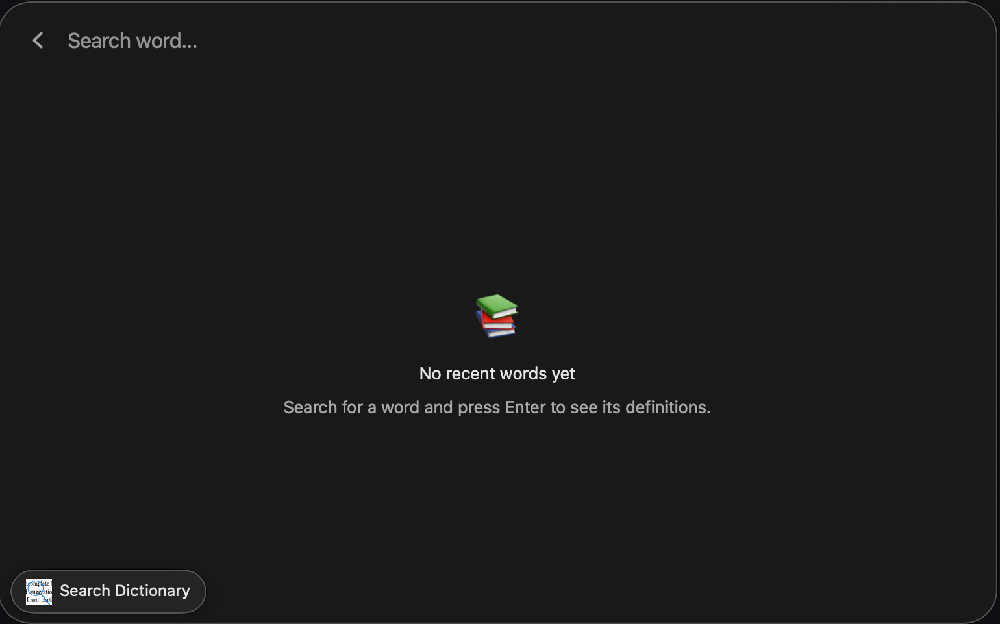
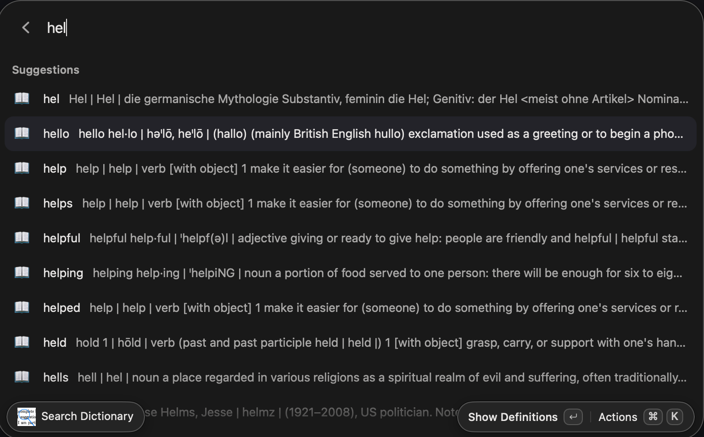
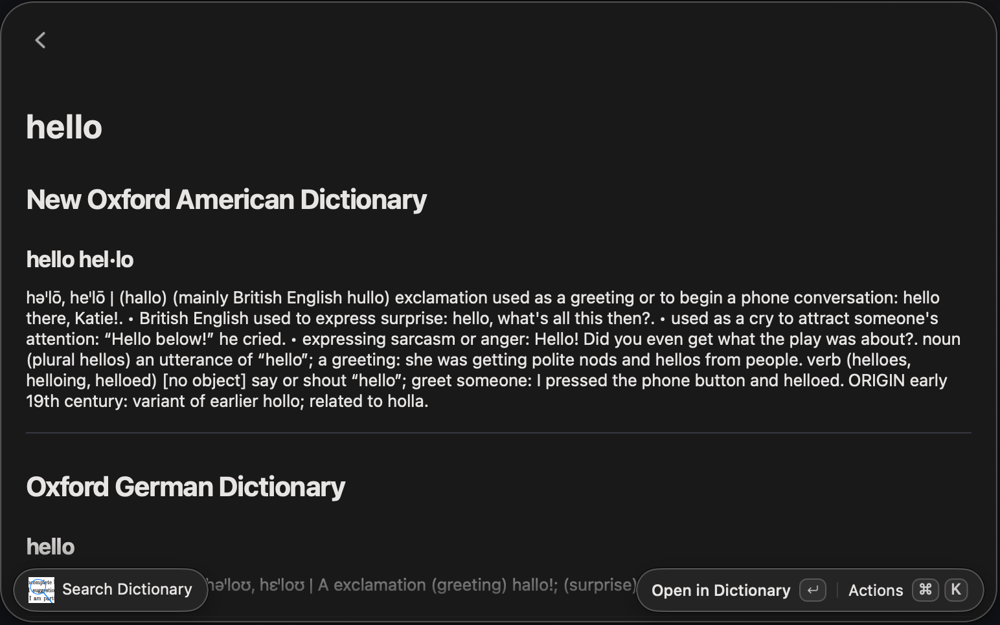
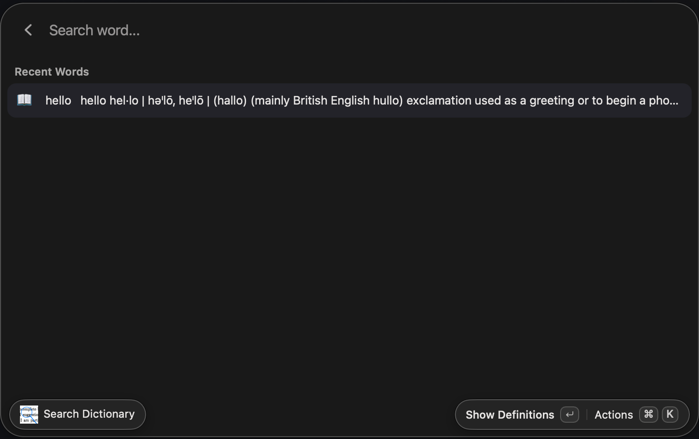

# Dictionary for Vicinae (MacOS)

> [!IMPORTANT]
> Extension uses MacOS [builtin dictionary app](https://support.apple.com/en-ca/guide/dictionary/welcome/mac), which is MacOS specific and won't work on other platforms.

A dictionary extension for [Vicinae](https://github.com/vicinaehq/vicinae) that uses Apple's existing dictionary for lookup. This mimics the functionality of [Raycast](https://www.raycast.com/) builtin dictionary feature, which is [missing from Vicinae for to Linux compatibility reasons](https://github.com/vicinaehq/vicinae/issues/1298).

Implemented by ChatGPT-6 Luna and GLM-5.3-Flash in React and Swift.

Many similar extensions exist on the [Raycast](https://www.raycast.com/store) and [Vicinae](https://www.vicinae.com/extensions) extension stores. Look there if you don't like this one.

<div align="center">





</div>

### Requirements

- macOS
- Vicinae
- Node.js 20 or newer and npm
- Xcode Command Line Tools (`xcode-select --install`), needed to compile the Swift lookup helper on its first search

## Install

Extension is *not* currently available on Vicinae extension store. To install from source, clone the repository:

```sh
git clone https://github.com/andrei-akopian/VicinaeMacOSDictionary
cd VicinaeMacOSDictionary
```

and run

```sh
npm install
npm run dev
```

With Vicinae running, the extension will appear in root search as **Search Dictionary**. Type a word or phrase to look it up. The first lookup compiles `assets/dictlook.swift` into Vicinae's writable extension support directory; later searches reuse that binary. Definitions are queried from the dictionaries currently enabled in Dictionary.app.

To build a release extension, run `npm run build` from an environment where Vicinae's `vici` CLI is available.

## Notes

- This extension is macOS-only.
- Enable or disable lookup sources in Dictionary.app → Settings.
- **Open in Dictionary** hands the entry off to the system `dict://` URL handler.
- Results are queried separately from each active Dictionary.app source, so the same word can appear once per matching dictionary.
- macOS does not expose a public API for enumerating per-dictionary results. The helper uses undocumented Dictionary Services symbols and the `DCSActiveDictionaries` preference to enumerate sources; Apple could change these between macOS releases.
- The extension does not parse or bundle dictionary data.
- [ ] TODO publish on Vicinae store after testing.

## License

This extension was developed using ChatGPT-6 Luna and GLM-5.3-Flash.

[MIT](./LICENSE.md) Licensed and developed on [(this) Github Repository](https://github.com/andrei-akopian/VicinaeMacOSDictionary).
